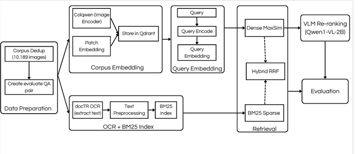

Project II - 2025.2 (6/2026) - IT3920E

# Project II: Comparing Training-Free Search Strategies for Multimodal Document Question-Answering with ColQwen2

## 📌 Overview
This project builds and compares a multimodal document retrieval system (DocVQA) comprising **4 fully training-free strategies**, based on pretrained models without fine-tuning. The goal is to evaluate retrieval performance, accuracy-latency trade-offs, and provide practical recommendations for RAG systems.

## 🏗️ System Architecture

The pipeline consists of the following core components:
*   **Data Preparation:** Deduplication of the corpus (10,189 images) and creation of the evaluation QA pairs.
*   **Corpus Embedding:** Dense retrieval pipeline using **ColQwen2** (Image Encoder + Patch Embedding) with a late-interaction **MaxSim** mechanism on patch-level embeddings, stored in the **Qdrant** vector database.
*   **OCR + BM25 Index:** Sparse retrieval pipeline using **docTR** for text extraction, text preprocessing, and **BM25** (rank_bm25) as a lexical baseline.
*   **Retrieval & Ranking:** 
    *   **Dense MaxSim:** Direct retrieval from Qdrant.
    *   **BM25 Sparse:** Lexical retrieval.
    *   **Hybrid RRF:** Combination of dense and sparse signals using Reciprocal Rank Fusion (K = 60).
    *   **VLM Re-ranking:** Using **Qwen2-VL** as a re-ranker on the top-10 dense results, using the log-probability of the "yes" token as the relevance score.
*   **Evaluation:** Assessment using standard retrieval metrics.

## 🛠️ Implementation Details

1.  **Dense Retrieval (ColQwen2):** Leverages patch-level embeddings and late-interaction MaxSim. Vectors are stored and queried via Qdrant.
2.  **Sparse Retrieval (BM25):** Uses docTR for OCR and `rank_bm25` for lexical matching.
3.  **Hybrid Fusion (RRF):** Combines dense and sparse results using Reciprocal Rank Fusion with `K = 60` to evaluate signal complementarity.
4.  **VLM Re-ranking (Qwen2-VL):** Applies a Vision-Language Model to re-rank the top-10 dense results.

## 📊 Experimental Setup & Results

*   **Dataset:** 2,000 validation questions from DocVQA.
*   **Corpus:** 10,189 deduplicated document images.
*   **Metrics:** Recall@1/5/10, MRR@10, and NDCG@10.

### Key Findings
*   **Best Performance:** **ColQwen2 (Dense)** achieved the highest results with **Recall@1 = 37.75%** and **NDCG@10 = 0.4992**.
*   **Hybrid & Re-ranking:** Hybrid RRF and VLM re-ranking did **not** improve results in this specific setup.
*   **Trade-off Analysis:** VLM re-ranking costs approximately **2–5 seconds per query**, whereas dense retrieval is significantly faster. 
*   **Recommendation:** Based on the results, **dense retrieval is highly recommended** for practical RAG systems due to its superior accuracy and lower latency.

## ⚠️ Limitations
*   OCR quality issues affecting the sparse retrieval pipeline.
*   Library version conflicts (PyTorch / CUDA / Flash-Attention).
*   GPU resource constraints during VLM re-ranking.

## 🚀 Future Work
*   Fine-tune ColQwen2 using contrastive learning.
*   Improve the OCR pipeline quality.
*   Explore learned fusion methods for combining dense and sparse retrieval.
